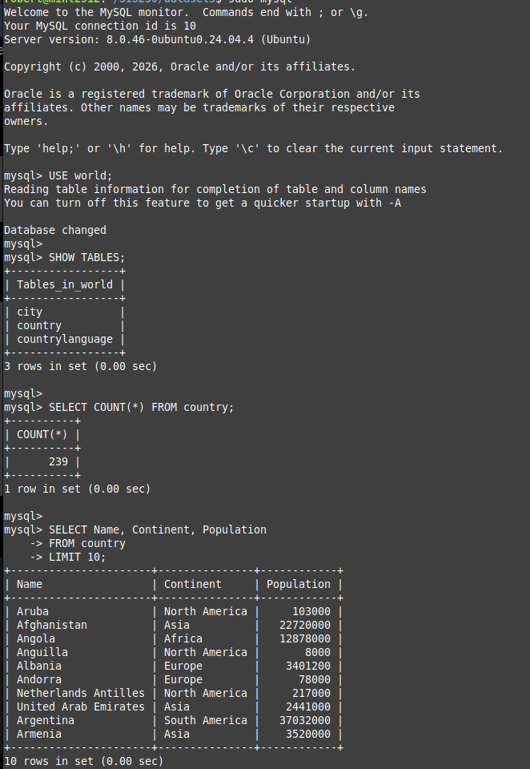

# MySQL on Linux Mint Lab
A hands-on learning project documenting MySQL setup and SQL practice on Linux Mint.


## Project Overview

This project documents my experience setting up and exploring MySQL on Linux Mint. I created this lab to practice managing a database server, importing a sample database, and writing SQL queries.

The project builds on concepts I am learning in my database coursework and provides a local environment where I can continue practicing.

## Objectives

- Verify that MySQL is installed and running.
- Connect to MySQL through the Linux terminal.
- Import the MySQL `world` sample database.
- Explore database tables and run SQL queries.
- Continue practicing database concepts and documenting my progress.

## Lab Environment

| Component | Details |
| --- | --- |
| Operating system | Linux Mint 22.3 Cinnamon |
| Database server | MySQL 8.0.46 |
| Interface | Linux terminal and MySQL command-line client |
| Sample database | MySQL `world` database |

## Project Status

**In progress:** MySQL is running, and I have imported and queried the `world` sample database. I plan to continue adding queries, examples, and documentation as I learn.

## Verify MySQL

I used the following commands to confirm that MySQL was installed and the server was running.

### Check the MySQL version

```bash
mysql --version
```

This displayed MySQL version **8.0.46** in my environment.

### Check the MySQL service

```bash
systemctl status mysql
```

The service status showed **active (running)** and **enabled**.

### Connect to MySQL

```bash
sudo mysql
```

This opened the MySQL command-line monitor.

### Verify the server version and list databases

At the `mysql>` prompt, I ran:

```sql
SELECT VERSION();
SHOW DATABASES;
```

The output displayed the server version and the default databases available at the time.

### Exit MySQL

```sql
EXIT;
```

This returned me to the Linux terminal.

## Import the World Sample Database

To practice SQL locally, I downloaded MySQL's `world` sample database and extracted the SQL file.

### Download and extract the database

```bash
mkdir -p ~/SIS230/datasets
cd ~/SIS230/datasets
wget https://downloads.mysql.com/docs/world-db.zip
unzip world-db.zip
```

The extracted file was located at `world-db/world.sql`.

### Import the database

```bash
sudo mysql < ~/SIS230/datasets/world-db/world.sql
```

I then opened the MySQL command-line monitor:

```bash
sudo mysql
```

### Explore the database

At the `mysql>` prompt, I selected the database and listed its tables:

```sql
USE world;
SHOW TABLES;
```

The database contained three tables: `city`, `country`, and `countrylanguage`.

### Run the first queries

I checked the number of rows in the `country` table:

```sql
SELECT COUNT(*) FROM country;
```

The result was **239 rows**.

I then displayed the name, continent, and population for ten countries:

```sql
SELECT Name, Continent, Population
FROM country
LIMIT 10;
```

This helped me practice selecting specific columns and limiting query results.

### Query Results

This screenshot shows the tables in the `world` database, the country count, and the results of my first query.



## Skills Practiced

- Verifying and managing a MySQL service on Linux.
- Using the Linux terminal and MySQL command-line client.
- Downloading, extracting, and importing a sample database.
- Exploring database tables and writing basic SQL queries.
- Documenting a technical project with GitHub.
  
## Future Improvements

- Practice filtering and sorting query results with `WHERE` and `ORDER BY`.
- Explore relationships between the `world` database tables using `JOIN`.
- Create a separate practice database for experimenting with tables and data.
- Practice inserting, updating, and deleting records locally.
- Add more screenshots and document what I learn.

## References

- [MySQL documentation: World sample database](https://dev.mysql.com/doc/world-setup/en/)
- [MySQL documentation](https://dev.mysql.com/doc/)
